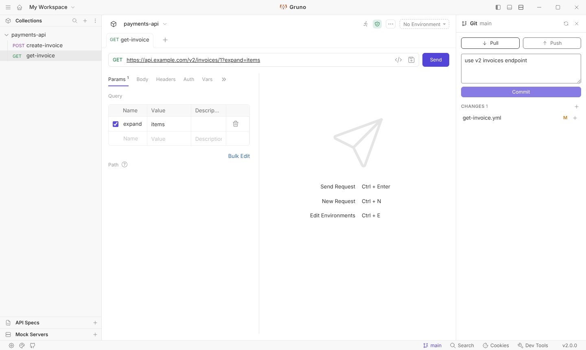
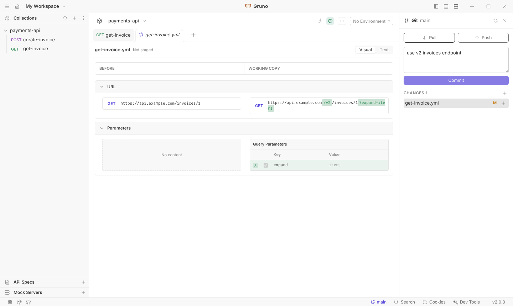

<br />


### Gruno: an open source API client with Git built into the interface

Gruno is a desktop app for exploring and testing APIs. Your collections live as plain files in a folder on your computer, and Gruno lets you review, commit, pull and push those files without leaving the app.

It runs fully offline: no account, no login and no cloud sync.



## Features

- **HTTP, GraphQL, gRPC and WebSocket requests**, with environments, variables, auth, scripts and tests.
- **Collections as files.** Requests are saved as `.bru` or `.yml` files, so they can be versioned like any code.
- **Git panel.** Open it from the branch name in the status bar:
  - see the branch and how many commits are ahead of or behind the remote;
  - stage and unstage files, write a message and commit;
  - pull (fast-forward) and push to `origin`;
  - initialise a repository for a collection that is not in one yet.
- **Diffs of your changes.** Click a changed file to open its diff: a visual comparison of the request (URL, parameters, headers, auth and body) or the plain text patch.
- **Imports** from Postman, Insomnia, OpenAPI/Swagger and WSDL.



## Download

Installers for macOS, Windows and Linux are published on the [Releases page](https://github.com/theusmoreira/gruno/releases).

The macOS build is not signed yet. The first time you open it, right-click the app and choose **Open**, or run:

```bash
xattr -dr com.apple.quarantine /Applications/Gruno.app
```

## Build from source

You need Node.js 22 (see `.nvmrc`) and Git.

```bash
nvm use
npm i --legacy-peer-deps
npm run setup              # builds the shared packages

npm run dev                # run the app in development mode

npm run build:web          # build the interface
npm run build:electron:mac # package the app (also :win, :linux, :deb, :rpm, :snap)
```

Installers are written to `packages/bruno-electron/out/`.

## Contributing

See [contributing.md](contributing.md). Bugs and ideas go to the [issue tracker](https://github.com/theusmoreira/gruno/issues).

## Credits

Gruno is a fork of [Bruno](https://github.com/usebruno/bruno), the open source API client created by Anoop M D, Anusree P S and contributors. Gruno keeps Bruno's collection format, so collections move freely between the two apps. "Bruno" is a trademark of its authors; Gruno is an independent project and is not affiliated with or endorsed by them.

## License

[MIT](license.md). The original Bruno copyright notice is kept in the license file, as the MIT license requires.
